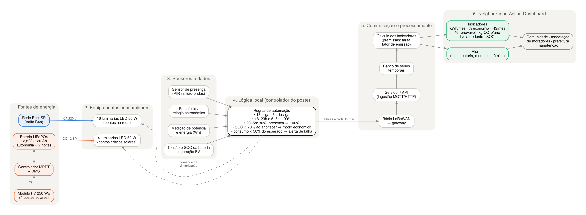

# Neighborhood Action Dashboard: Praça comunitária com iluminação eficiente e solar

**Global Solution 2026.2 · Ciência da Computação (1CC) · Soluções em Energias Renováveis e Sustentáveis (SERS)**

> **Contribuição de SERS:** este repositório (ou a pasta `sers/` no repositório integrador) contém a análise energética, os cálculos, o diagrama da solução e o módulo de energia do *Neighborhood Action Dashboard*.

## Integrantes

| Nome completo | RM |
|---|---|
| Felipe Oliveira Barcelos | RM576561 |
| Felipe Arruda Calixto | 574454 |


🎥 **Vídeo técnico (YouTube, não listado):https://youtu.be/Ih_GNpkuR6M
📊 **Dashboard:** abra `dashboard/index.html` no navegador (ou publique a pasta no GitHub Pages)

---

## 1. Diagnóstico do problema

| Item | Descrição |
|---|---|
| **Espaço escolhido** | Praça comunitária de bairro residencial (~4.000 m²) na Região Metropolitana de São Paulo, área de concessão da Enel SP. Cenário de referência, representativo de praças que ainda usam iluminação a vapor de sódio. |
| **Problema energético** | 20 postes com lâmpadas de vapor de sódio de alta pressão (VSAP) de 150 W, mais o reator, ficam **100% acesos das 18h às 6h**, inclusive de madrugada, quando quase ninguém passa. Isso dá **1.224 kWh/mês**. A luz amarela tem baixa reprodução de cor, a lâmpada contém mercúrio e ninguém fica sabendo quando um ponto queima: a manutenção só acontece depois de reclamação. Quando falta energia na rede, a praça fica toda no escuro. Os apagões de set.–dez./2025 em SP chegaram a atingir 3 milhões de consumidores (R10). |
| **Público beneficiado** | ~3.000 moradores do entorno (raio de ~400 m). Inclui quem atravessa a praça para o ponto de ônibus, crianças e jovens na quadra, idosos na academia ao ar livre e a feira de fim de semana. Prefeitura e equipe de manutenção também se beneficiam. |
| **Condições de funcionamento** | Acendimento por fotocélula (~12 h/noite). Rede de baixa tensão já existe nos postes. Pontos críticos (entrada, travessia para o ônibus, quadra e caminho interno) recebem sol direto, sem sombra de árvores. Comunicação por LoRaWAN, com um gateway para toda a praça. |
| **Benefícios esperados** | Menos energia e menos custo para o município. Luz branca e direcionada, que melhora a percepção de segurança. Pontos críticos continuam acesos durante apagões. Alerta automático de luminária queimada. Fim das lâmpadas com mercúrio. Indicadores públicos no dashboard para a associação de moradores acompanhar. |

## 2. Análise do consumo energético

Expressão usada: **E = (P × t) / 1000**, com E em kWh, P em W e t em h. Os períodos de referência são o **dia**, o **mês de 30 dias** e o **ano de 365 dias**.

| Tecnologia (por ponto) | Cálculo | Energia |
|---|---|---|
| VSAP 150 W + reator 20 W, 100% por 12 h | (170 × 12) / 1000 | **2,040 kWh/dia** |
| LED 60 W, plena das 18–23h e 5–6h (6 h) | (60 × 6) / 1000 | 0,360 kWh |
| LED dimerizado das 23–5h (6 h): 30% de base + 20% do tempo a 100% por presença → 26,4 W médios | (26,4 × 6) / 1000 | 0,158 kWh |
| Controlador com sensor e rádio (1 W × 24 h) | (1 × 24) / 1000 | 0,024 kWh |
| **LED com sensor (total)** | | **0,542 kWh/dia** (−73,4%) |

Situação atual: 20 pontos × 2,040 kWh × 30 dias = **1.224 kWh/mês** (14.892 kWh/ano).
Memorial completo, gerado automaticamente: [`outputs/memorial_calculo.md`](outputs/memorial_calculo.md).

## 3. Comparação das alternativas

Todas as alternativas LED entregam **o mesmo serviço de iluminação** (mesma potência e mesmo perfil de dimerização). O que muda entre elas é **a fonte de energia**. O horizonte é de 15 anos, com valores constantes.

| Indicador | A0 Atual (sódio) | A1 LED + sensor (rede) | A2 LED solar (100% renovável) | **A3 Híbrida (recomendada)** |
|---|---|---|---|---|
| Composição | 20 VSAP | 20 LED na rede | 20 postes solares off-grid | 16 LED na rede + 4 solares |
| Consumo da rede (kWh/mês) | 1.224 | 325 | 0 | **260** |
| Economia de energia da rede | — | 73,4% | 100% | **78,7%** |
| Renovável local | 0% | 0% | 100% | **20%** |
| Custo operacional (R$/mês) | 754 | 245 | 130 | **222** |
| Redução de custo (R$/mês) | — | 509 | 624 | **532** |
| Emissões evitadas (kg CO₂e/ano) | — | 421 | 573 | **451** |
| Investimento inicial | R$ 0 | R$ 31.000 | R$ 112.152 | **R$ 47.230** |
| Payback simples | — | 5,1 anos | 15,0 anos | **7,4 anos** |
| Payback com troca de baterias | — | 5,1 anos | não se paga em 15 anos | **8,9 anos** |
| Custo total em 15 anos | R$ 135.690 | R$ 75.096 | R$ 184.704 | **R$ 97.018** |
| Pontos acesos em apagão | 0 | 0 | 20 | **4** |
| Lâmpadas com mercúrio | 20 | 0 | 0 | 0 |

**Dimensionamento do poste solar** (por ponto, mês crítico = junho):
- Demanda: 542 Wh/dia. Rendimento global do sistema isolado: PR = 0,96 × 0,92 × 0,90 × 0,95 × 0,98 = **0,74**.
- Módulo: 542 / (3,4 h × 0,74) = 216 Wp mínimo → **250 Wp**. No mês crítico gera 629 Wh/dia, uma margem de 16%.
- Bateria: 542 × 2 noites / (0,80 × 0,95) = 1.427 Wh → **LiFePO4 12,8 V 120 Ah (1,54 kWh)**, com autonomia real de 2,2 noites.
- Custo por ponto: R$ 5.458, contra R$ 1.400 do LED na rede. A bateria responde por 45% desse valor e é trocada no ano 8.

| Critério | A1 LED + sensor (rede) | A2 100% solar | A3 Híbrida |
|---|---|---|---|
| **Viabilidade técnica** | Alta: usa postes e rede existentes. Exige projeto luminotécnico (NBR 5101) e luminária com base para controlador. | Média: cada poste precisa de sol sem sombra, suporte para o módulo e caixa antifurto para a bateria. | Alta: o solar fica só nos 4 pontos críticos com boa insolação. |
| **Impactos ambientais** | Elimina o mercúrio e reduz a poluição luminosa. As luminárias antigas precisam de descarte adequado. | 100% renovável local, mas são 20 baterias para logística reversa (Lei 12.305/2010, R14), além das emissões de fabricação. | Elimina o mercúrio, com 20% renovável local e só 4 baterias. |
| **Benefícios** | Menor custo total. Luz branca. Alertas de falha. | Independe da rede e funciona em apagão. Serve onde não há rede. | Pontos críticos acesos em apagão. Vitrine educativa de energia solar. |
| **Limitações** | Depende 100% da rede. | Investimento 3,6× maior que A1. Risco de furto. O excedente de verão é desperdiçado (só 72% da geração anual é aproveitada). | Duas tecnologias para manter. Custa mais que A1. |

### Conclusão da comparação

1. **A eficiência vem antes da renovável.** A troca do sódio pelo LED com sensor (A1) é responsável pela maior parte do ganho, com −73% de energia e payback de 5 anos. Gerar energia solar para alimentar uma carga ineficiente seria desperdício.
2. **Na rede urbana, 100% solar não se paga.** A tarifa de iluminação pública é baixa e a matriz elétrica brasileira já é majoritariamente renovável (38,5 kg CO₂/MWh). Por isso A2 custa **R$ 109 mil a mais que A1 em 15 anos** para evitar só 152 kg CO₂/ano, o que dá cerca de R$ 48 mil por tonelada. Pela análise de equilíbrio, A2 só empataria com A1 com tarifa acima de **R$ 2,35/kWh**, ou em pontos novos onde levar a rede custasse mais de **R$ 5.480 por ponto** (vala, eletroduto e cabo).
3. **Recomendação: A3 Híbrida.** Ela leva o ganho de eficiência de A1 a todos os pontos e usa o solar só onde ele entrega algo que a rede não entrega: **resiliência**. A entrada, a travessia para o ônibus, a quadra e o caminho interno continuam acesos em apagão. A diferença de custo para A1 é de R$ 21.922 em 15 anos, ou **~R$ 122/mês**, e é o preço explícito dessa resiliência. Se a prioridade for só custo, A1 é a escolha. O dashboard permite comparar as duas.

Sensibilidade à tarifa (R$/kWh → payback simples de A1 / A3): 0,40 → 6,2 / 9,1 anos · 0,50 → 5,1 / 7,4 · 0,70 → 3,7 / 5,4 · 0,90 → 3,0 / 4,3.

## 4. Diagrama da solução



Fonte editável em [`docs/diagrama.dot`](docs/diagrama.dot) (Graphviz). Os blocos:

1. **Fonte de energia:** rede Enel SP (16 pontos) e, nos 4 postes solares, módulo FV 250 Wp → controlador MPPT/BMS → bateria LiFePO4.
2. **Equipamentos consumidores:** luminárias LED de 60 W com driver dimerizável.
3. **Sensores e dados:** sensor de presença (PIR/micro-ondas), fotocélula ou relógio astronômico, medição de potência e energia no controlador, tensão e estado de carga (SOC) da bateria e geração FV.
4. **Lógica local (controlador do poste):**
   - liga às 18h e desliga às 6h;
   - fica a 100% das 18–23h e das 5–6h;
   - das 23h às 5h fica a 30%, e a presença leva a 100% por ~2 min;
   - se o SOC ao anoitecer estiver abaixo de 70%, entra em **modo econômico** (70% / 20%);
   - se o consumo da noite ficar abaixo de 50% do esperado, gera **alerta de falha**.
5. **Processamento:** leituras a cada 15 min via LoRaWAN → gateway → servidor/API (MQTT/HTTP) → banco de séries temporais → cálculo dos indicadores com as premissas (tarifa, fator de emissão).
6. **Dashboard:** indicadores, comparação de alternativas, mapa de status e alertas para a comunidade e a manutenção.

## 5. Indicadores de eficiência e sustentabilidade

| Indicador | Unidade | Valor A3 | Como é calculado |
|---|---|---|---|
| Consumo de energia da rede | kWh/mês | 260 | Σ pontos na rede × E por ponto × 30 |
| Economia energética estimada | kWh/mês e % | 964 · 78,7% | (A0 − A3) / A0 |
| Redução estimada de custos | R$/mês | 532 | (energia × tarifa + O&M) de A0 − mesmo cálculo de A3 |
| Participação de energia renovável | % | 20% | carga atendida pelos postes solares / carga total |
| Emissões evitadas estimadas | kg CO₂e/ano | 451 | kWh/ano evitados × 0,0385 kg/kWh |
| Tempo de funcionamento eficiente | h/dia | 6 | horas em modo dimerizado com sensor |
| Payback | anos | 7,4 (8,9 com bateria) | investimento / economia anual; versão com fluxo de custos |
| Pontos acesos em apagão | pontos | 4 | postes com bateria própria |
| Estado de carga das baterias (monitoramento) | % | — | leitura do BMS ao fim de cada noite |

Monitoramento simulado de junho (`src/simulacao.py`, dados **simulados**):
- **Rede:** 254 kWh no mês, contra 260 kWh estimados. A diferença vem da falha simulada no P11 a partir do dia 21, que o sistema detectou.
- **Solar:** 63 kWh, ou 19,8% da iluminação.
- **Modo econômico:** acionado em 27 de 120 poste-noites.
- **Reserva de 20% das baterias:** só foi atingida na sequência de 2 dias nublados (dias 12–13), nos pontos de maior movimento. Daí vem a recomendação de usar módulo de 300 Wp em P01–P03.

## 6. Integração ao Neighborhood Action Dashboard

O módulo de energia fica em [`dashboard/`](dashboard/) e não tem dependências externas (HTML + JS puro):

| Arquivo | Função |
|---|---|
| `index.html` / `app.js` | Painel com os indicadores por alternativa, gráficos de comparação, diagrama, monitoramento (mapa de status, perfil noturno, energia diária, SOC das baterias, alertas) e simulador de premissas |
| `modelo.js` | Porta em JS das fórmulas de `src/modelo.py`, usada pelo simulador. A equivalência é testada por `src/verificar_js.cjs` |
| `data.js` | Dados gerados por `src/main.py` (`window.SERS_DATA = {premissas, resultados, monitoramento}`) |

Para integrar com o projeto das outras disciplinas, consuma `outputs/resultados.json`, que traz os indicadores de cada alternativa, ou os CSVs de `data/`, que têm as leituras simuladas por ponto e por hora. Os dois são gerados pelo mesmo script.

## 7. Estrutura e como reproduzir

```
data/premissas.json                    premissas e fontes (edite aqui)
data/monitoramento_simulado_*.csv      leituras simuladas (horária e diária)
src/modelo.py                          cálculos de energia, dimensionamento, custos e indicadores
src/simulacao.py                       simulação de 30 dias de monitoramento
src/main.py                            gera outputs/, data/*.csv e dashboard/data.js
src/test_modelo.py                     testes dos cálculos
src/verificar_js.cjs                   confere modelo JS = modelo Python
outputs/resultados.json                resultados de todas as alternativas
outputs/memorial_calculo.md            memorial de cálculo passo a passo
docs/diagrama.dot|svg|png              diagrama de blocos
docs/roteiro_video.md                  roteiro do vídeo de 3 min
dashboard/                             módulo de energia do dashboard
```

```bash
python src/main.py           # Python 3.10+, só biblioteca padrão
python src/test_modelo.py    # testes
node src/verificar_js.cjs    # opcional: confere o modelo JS
# abrir dashboard/index.html no navegador
```

## 8. Dados utilizados e fontes

| Ref. | Dado | Fonte |
|---|---|---|
| R1 | Reajuste médio de 10,18% da Enel SP (jun/2026) | [IstoÉ Dinheiro, 30/06/2026](https://istoedinheiro.com.br/conta-de-luz-enel-sao-paulo) |
| R2 | Tarifa B1 residencial Enel SP: R$ 725,18/MWh (2025) | [Exame, jul/2025](https://exame.com/economia/conta-de-luz-sp-aumento-enel-reajuste-tarifa-aneel-julho) |
| R3 | Fator médio de emissão do SIN 2023: 38,5 kg CO₂/MWh (MCTI) | [O Setor Elétrico](https://www.osetoreletrico.com.br/?p=159478) |
| R4 | Fatores mensais do SIN em 2025: 21,5 a 28,9 kg CO₂/MWh (MCTI/SIRENE) | [Canal Solar](https://canalsolar.com.br/emissoes-de-co%e2%82%82-geracao-eletrica-mcti/) |
| R5 | Inclinação ótima em SP de 23°; PR típico de 0,75 | [USP IEE0004, Aula 11 (R. Zilles)](https://edisciplinas.usp.br/pluginfile.php/6848059/mod_resource/content/5/undefined/Curso_IEE0004_Aula_11_2022_1.pdf) |
| R6 | Irradiação mensal (S. J. dos Campos): junho com 3,2 kWh/m² (0°) e 4,2 (23°) | [USP e-Disciplinas](https://edisciplinas.usp.br/mod/resource/view.php?id=4094582) |
| R7 | Irradiação média anual em superfície ótima, São Paulo: 4,09 kWh/m²·dia | [USP e-Disciplinas](https://edisciplinas.usp.br/mod/resource/view.php?id=4094581) |
| R8 | Ferramenta de irradiação por localidade | [CRESESB SunData](https://cresesb.cepel.br/sundata/index.php?&lang=en) |
| R9 | Postes solares comerciais com LiFePO4 e sensor de movimento | [Signify SmartBright (ficha técnica)](https://www.signify.com/api/assets/v1/file/Signify/content/911401833902_EU.pt_BR.PROF.FP/BRP110_LED50_757_G2.pdf) |
| R10 | Apagões de set.–dez./2025 em SP (até 3 milhões de consumidores) | [Prefeitura de São Paulo](https://prefeitura.sp.gov.br/w/prefeitura-aplica-multa-de-r-11-4-milh%C3%B5es-%C3%A0-enel-por-falhas-no-fornecimento-de-energia) |
| R11 | Substituição de lâmpadas de sódio por LED na iluminação pública de SP | [SP Regula](https://prefeitura.sp.gov.br/web/spregula/w/iluminacao_publica/noticias/319281) |
| R12 | Potencial de eficiência na iluminação pública paulista: 1.249 GWh/ano | [BID](https://publications.iadb.org/publications/portuguese/document/Avaliacão-do-potencial-de-eficiência-energetica-na-iluminacão-publica-nos-municipios-paulistas.pdf) |
| R13 | ABNT NBR 5101: Iluminação pública, procedimento | ABNT |
| R14 | Política Nacional de Resíduos Sólidos (logística reversa) | [Lei 12.305/2010](https://www.planalto.gov.br/ccivil_03/_ato2007-2010/2010/lei/l12305.htm) |
| R15 | Preços de varejo de luminárias LED públicas (ordem de grandeza) | [Magalu (busca)](https://www.magazineluiza.com.br/busca/poste+publica) |

## 9. Limitações da proposta

- **Projeções, não garantias:** todos os números dependem das premissas de `data/premissas.json`. O dashboard tem um simulador para testar outras premissas.
- **Tarifa estimada:** a B4a foi estimada em ~55% da B1 mais tributos. Antes de qualquer decisão, confirmar na Resolução Homologatória vigente da Enel SP.
- **Custos aproximados:** são ordens de grandeza tiradas de catálogos e varejo, não um orçamento comercial. Não incluem licitação, projeto executivo nem reforço de postes.
- **Luminotécnica pendente:** a equivalência entre LED 60 W e VSAP 150 W precisa ser confirmada por projeto luminotécnico (NBR 5101).
- **Sem ciclo de vida completo:** as emissões evitadas consideram só a energia da rede. As emissões de fabricação de módulos, baterias e luminárias ficaram de fora.
- **Monitoramento simulado:** a fração de presença (20%) e a falha do P11 foram simuladas. Em campo, essas premissas devem ser calibradas com os dados reais dos sensores.
- **Risco operacional dos postes solares:** furto e vandalismo de módulos e baterias e sombreamento futuro por árvores.
- **Próximo passo:** avaliar a compensação de energia (Lei 14.300/2022) com geração FV conectada à rede em um prédio público próximo, como alternativa ao solar isolado.
